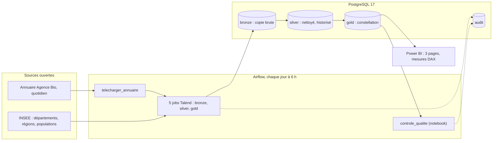
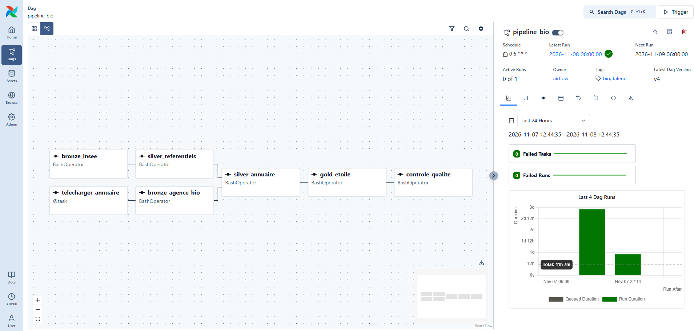
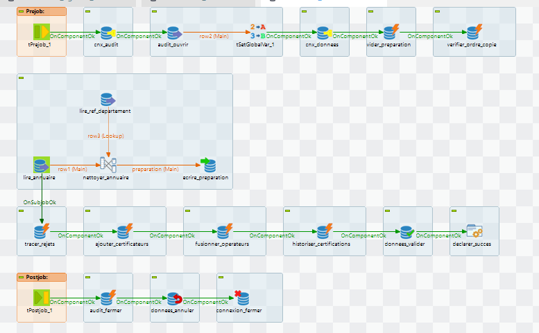
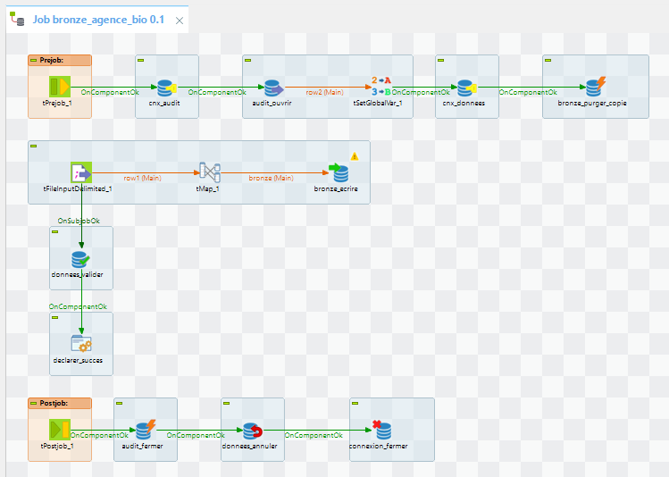
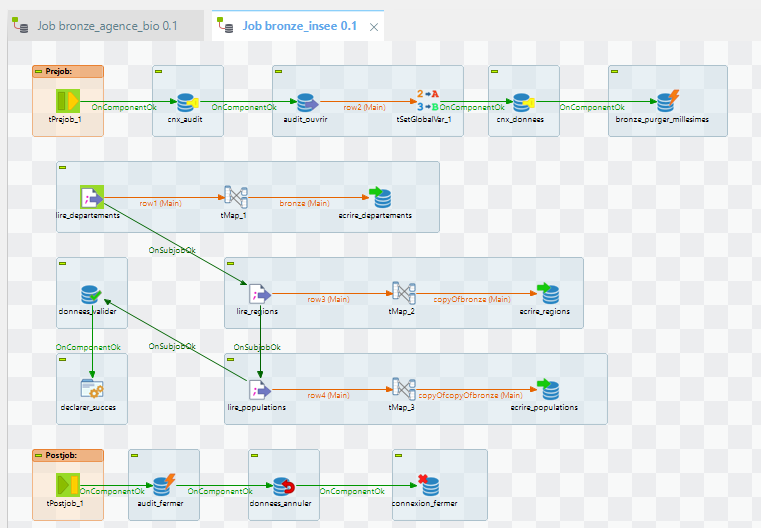
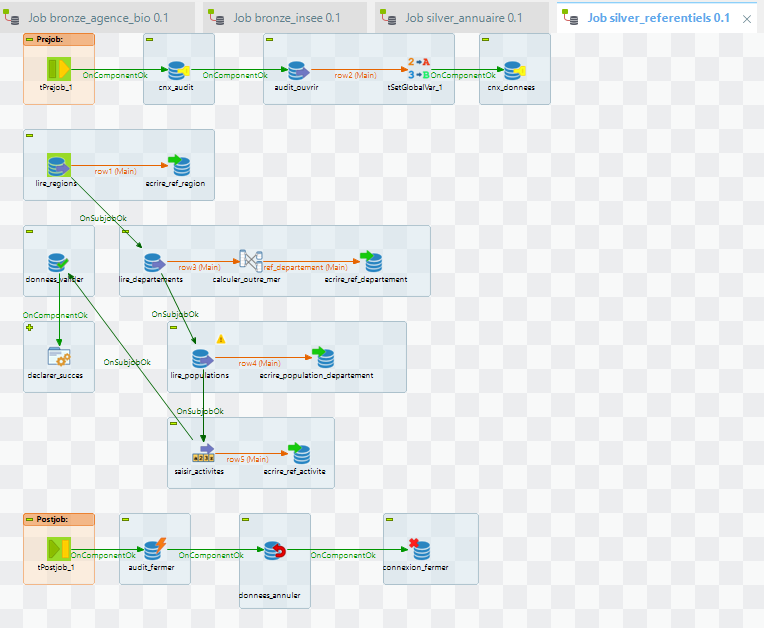
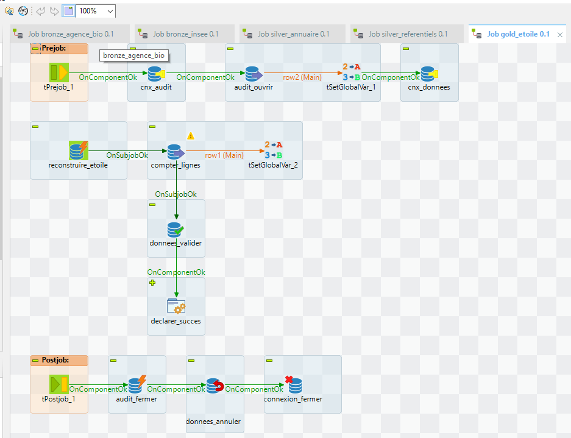
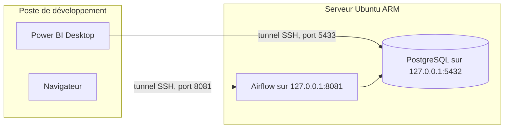

# Observatoire territorial de la filière bio

**Auteur : Martial GADJEU** | Data & AI Engineer

Pipeline de données de bout en bout qui transforme l'annuaire public des **88 000 opérateurs bio certifiés en France**
en tableau de bord de pilotage : où la filière manque-t-elle de transformateurs, comment se développe-t-elle,
et qui la certifie ?

**Talend** (ETL) · **PostgreSQL** (architecture médaillon, SCD 2) · **Airflow** (orchestration quotidienne) ·
**Power BI** (DAX) · **Docker** · **GitHub Actions** (CI) · en production sur un serveur **Linux Ubuntu**


## Ce que montre l'observatoire

| Page | Question | Résultat sur la copie du 8 novembre 2026 |
|---|---|---|
| **Structure** | Où produit-on sans transformer ? | 62 005 producteurs pour 42 092 transformateurs. **7 déserts de transformation**, dont 6 en Occitanie : le Gers compte 1 940 producteurs pour un ratio de transformation de 18 % (68 % en moyenne) |
| **Développement** | Comment la filière grandit-elle ? | Forte croissance de 2015 à 2021, recul en 2022-2023. Entrées et sorties d'opérateurs suivies chaque jour grâce à l'historique |
| **Marché** | Qui certifie, avec quelle concentration ? | Marché **très concentré** (indice HHI de 3 782) : Ecocert certifie 56 % des opérateurs, jusqu'à 97 % en Guyane |

| Développement | Marché |
|---|---|
|  |  |

**Consulter le rapport** : [export PDF des trois pages](docs/observatoire_bio.pdf), ou le fichier Power BI complet
avec ses données (`observatoire_bio.pbix`) dans la [dernière version publiée](../../releases/latest),
à ouvrir avec Power BI Desktop (gratuit).

## Architecture



Les cinq jobs Talend, dans l'ordre de leurs dépendances : `bronze_agence_bio` et `bronze_insee` (en parallèle),
`silver_referentiels`, `silver_annuaire`, puis `gold_etoile`.

| Couche | Contenu | Points clés |
|---|---|---|
| **bronze** | Copie fidèle des fichiers, tout en texte | Colonnes techniques (exécution, date de copie, fichier, ligne, empreinte MD5) ; idempotent (purge puis rechargement, dans une transaction) |
| **silver** | Données nettoyées et typées | SIRET contrôlé par la clé de Luhn, code postal, département déduit (Corse, outre-mer, étranger) ; opérateurs en **SCD 1**, certifications historisées en **SCD 2** ; rejets tracés dans `audit.rejet` |
| **gold** | Modèle en **constellation** : deux tables de faits (état du jour, entrées et sorties) et quatre dimensions conformes | Aucune donnée personnelle : l'opérateur n'y est qu'un pseudonyme ; Power BI n'a accès qu'à ce schéma |
| **audit** | Exécutions, rejets, contrôles qualité | Chaque job ouvre et ferme sa ligne d'audit, même en cas d'échec |

## Orchestration et jobs

Airflow lance chaque matin le téléchargement de la copie du jour, les cinq jobs Talend dans l'ordre de leurs
dépendances (les deux jobs bronze en parallèle), puis le contrôle qualité. Les jobs sont des exports autonomes
de Talend exécutés dans le conteneur Airflow, avec la date de copie passée en paramètre.



Chaque job Talend suit le même squelette : un **prejob** ouvre la ligne d'audit et une connexion transactionnelle,
le **traitement** écrit dans cette transaction, un **commit** valide le tout, et un **postjob**, toujours exécuté,
ferme l'audit, annule ce qui n'a pas été validé et libère les connexions.



*`silver_annuaire` : lecture de la copie en bronze, nettoyage dans le tMap (routine `Nettoyage`, jointure sur le
référentiel des départements), écriture dans une table de travail, puis appels des procédures de fusion
(rejets, organismes, opérateurs, SCD 2).*

<details>
<summary>Les quatre autres jobs</summary>

| `bronze_agence_bio` | `bronze_insee` |
|---|---|
|  |  |
| **`silver_referentiels`** | **`gold_etoile`** |
|  |  |

</details>

## Choix techniques

- **Talend pour le nettoyage ligne par ligne**, **SQL pour les fusions par ensembles** : la routine Java `Nettoyage`
  et le tMap (avec jointure sur le référentiel des départements) remplissent une table de travail ; des procédures
  stockées font la SCD 2, testées en CI sur deux copies successives.
- **Idempotence et atomicité** partout : relancer un jour ne crée aucun doublon ; un échec annule tout (rollback),
  tandis que l'audit, sur une connexion séparée, garde la trace de l'échec.
- **Copies traitées dans l'ordre** : une procédure refuse une copie plus ancienne que la dernière historisée, et
  Airflow n'exécute qu'un jour à la fois.
- **Moindre privilège** : un rôle par usage (`etl_writer`, `bi_reader` limité à gold, `qa_reader`, `airflow` sans
  accès aux données). Aucun secret dans Git : fichiers de contexte et `.env` exclus, mots de passe lus dans
  l'environnement.
- **Jobs portables** : un seul export Talend (*Build Job*) tourne sur le poste et dans le conteneur Airflow ; le
  fichier de réglages est choisi par la variable `TALEND_CONTEXTE`.
- **Rapport versionné comme du code** : format projet Power BI (`.pbip`, modèle TMDL), chaque mesure DAX est lisible
  dans Git.
- **Chiffres vérifiés** : chaque indicateur du rapport a été recalculé en SQL sur gold.

## Qualité et tests

- **CI GitHub Actions** : à chaque push, la base est créée sur un PostgreSQL vierge et 13 séries de tests vérifient
  schémas, rôles, droits, contraintes, la SCD 2 et l'absence de données personnelles en gold
  ([`sql/tests/test_init.sql`](sql/tests/test_init.sql)). Un second job vérifie le code Python avec ruff
  (PEP 8, erreurs), charge le DAG dans Airflow 3.3.2 pour contrôler ses tâches et ses dépendances
  ([`airflow/tests/test_dag.py`](airflow/tests/test_dag.py)), et valide le notebook de contrôle qualité.
- **Contrôle qualité quotidien** : un notebook exécuté par Airflow mesure 13 indicateurs sur les données réelles
  (volume de la copie, SIRET valides, unicité des versions SCD 2, rapprochements silver / gold…) et les enregistre ;
  un échec fait passer la tâche en rouge ([`notebooks/qualite`](notebooks/qualite)).

## Déploiement en production

Le pipeline tourne chaque matin sur un **serveur Ubuntu 24.04 (processeur ARM, Oracle Cloud)**, avec Docker Compose,
à côté d'autres services hébergés sur la même machine. Le poste de développement garde sa propre base pour
mettre au point jobs et mesures sans toucher à la production.



- **Aucun port ouvert sur Internet** : Airflow et PostgreSQL ne sont publiés que sur `127.0.0.1` du serveur. On y
  accède par des tunnels SSH, protégés par la clé SSH et chiffrés de bout en bout.
- **Secrets propres à la production**, générés sur le serveur (`openssl rand`) sans jamais être affichés ; fichiers
  lisibles par leur seul propriétaire, dont l'utilisateur 50000 qui exécute Airflow dans le conteneur.
- **Ressources plafonnées** (`mem_limit`) pour ne pas pénaliser les autres services, et port d'Airflow réglable
  (`AIRFLOW_PORT`) en cas de conflit.
- **Image reconstruite pour ARM** sur le serveur ; les jobs Talend, en Java, tournent sans modification.
- **Migration de l'historique** : données de bronze, silver, gold et audit transférées depuis la base de
  développement (`pg_dump --data-only`, `pg_restore --single-transaction`), puis rejeu d'une copie déjà traitée
  pour vérifier l'idempotence en production (aucune version SCD 2 créée).
- **Mise en production vérifiée** : tests de la base exécutés sur le serveur, DAG testé avant d'être activé.

<details>
<summary>Procédure de déploiement</summary>

```bash
git clone https://github.com/GuyMartial24/bio-operators-etl-pipeline.git && cd bio-operators-etl-pipeline
cp .env.example .env                                 # mots de passe générés par openssl rand, AIRFLOW_PORT si besoin
cp talend/contexte_docker.properties.example talend/contexte_docker.properties   # mot de passe d'etl_writer
sudo chown 50000 talend/contexte_docker.properties && sudo chmod 600 talend/contexte_docker.properties
# copier talend/build (jobs exportés) et data/raw (INSEE) depuis le poste, par scp
sudo chown -R 50000 data/raw/agence_bio              # Airflow y écrit la copie du jour
docker compose up -d postgres                        # base créée par sql/init
docker compose exec -T postgres sh -c 'psql -U "$POSTGRES_USER" -d "$POSTGRES_DB" -v ON_ERROR_STOP=1' < sql/tests/test_init.sql
docker compose build airflow && docker compose up -d airflow
docker compose exec airflow airflow dags test pipeline_bio AAAA-MM-JJ   # puis activer le DAG
```

Accès depuis le poste : `ssh -L 8081:127.0.0.1:8081 serveur` (Airflow sur http://localhost:8081) et
`ssh -L 5433:127.0.0.1:5432 serveur` (Power BI sur `127.0.0.1:5433`).

</details>

## Lancer le projet en local

Prérequis : Docker Desktop, et Talaxie Open Studio 8.9 pour modifier ou réexporter les jobs.

```bash
cp .env.example .env                       # puis choisir les mots de passe
cp talend/contexte_docker.properties.example talend/contexte_docker.properties   # mot de passe d'etl_writer
docker compose up -d                       # PostgreSQL (schémas, rôles, tables) et Airflow
```

- Exporter les cinq jobs depuis Talend (*Build Job*, type autonome) dans `talend/build/`.
- Ouvrir Airflow sur http://localhost:8080 (utilisateur `admin`, mot de passe dans
  `/opt/airflow/auth/passwords.json` du conteneur), puis activer le DAG `pipeline_bio`.
- Ouvrir `powerbi/observatoire_bio.pbip` dans Power BI Desktop, se connecter avec `bi_reader`.

## Structure du dépôt

| Dossier | Contenu |
|---|---|
| [`talend/`](talend) | Projet Talend : 5 jobs, routines `Empreinte` et `Nettoyage`, connexion et contexte |
| [`sql/init/`](sql/init) | Création de la base : rôles, schémas, droits, tables, procédures de fusion |
| [`sql/tests/`](sql/tests) | Tests exécutés par la CI |
| [`airflow/`](airflow) | Image Docker (Airflow 3.3 et Java 17) et DAG `pipeline_bio` |
| [`notebooks/`](notebooks) | Exploration des sources, contrôle qualité |
| [`powerbi/`](powerbi) | Rapport (format projet), fond de carte des départements |
| [`docs/`](docs) | [Cadrage](docs/cadrage.md), [modèle de données](docs/modele_donnees.md), [dictionnaire](docs/dictionnaire_donnees.md), [journal du projet](docs/journal.md) |

## Limites connues

- La source ne conserve que la dernière version de l'annuaire : un jour sans exécution est une copie perdue
  (d'où l'exécution sur un serveur toujours allumé). L'historique commence le 5 novembre 2026.
- Le graphique par année d'engagement ne montre que les opérateurs encore actifs (biais du survivant) ; les
  vraies entrées et sorties ne sont connues que depuis le début du suivi.
- Mayotte est absente des populations légales 2023 : pas d'indicateur par habitant pour ce département.
- Le département est déduit du code postal du siège : quelques communes sont desservies par le code postal d'un
  département voisin.

## Données

Annuaire des opérateurs bio : Agence Bio, sur [data.gouv.fr](https://www.data.gouv.fr/fr/datasets/professionnels-engages-en-bio/)
(Licence Ouverte). Code officiel géographique et populations légales : INSEE. Contours des départements :
fichier `departements-version-simplifiee.geojson` du projet france-geojson, converti en TopoJSON
([`powerbi/cartes`](powerbi/cartes)).

## Auteur

**Martial GADJEU** | Data & AI Engineer
