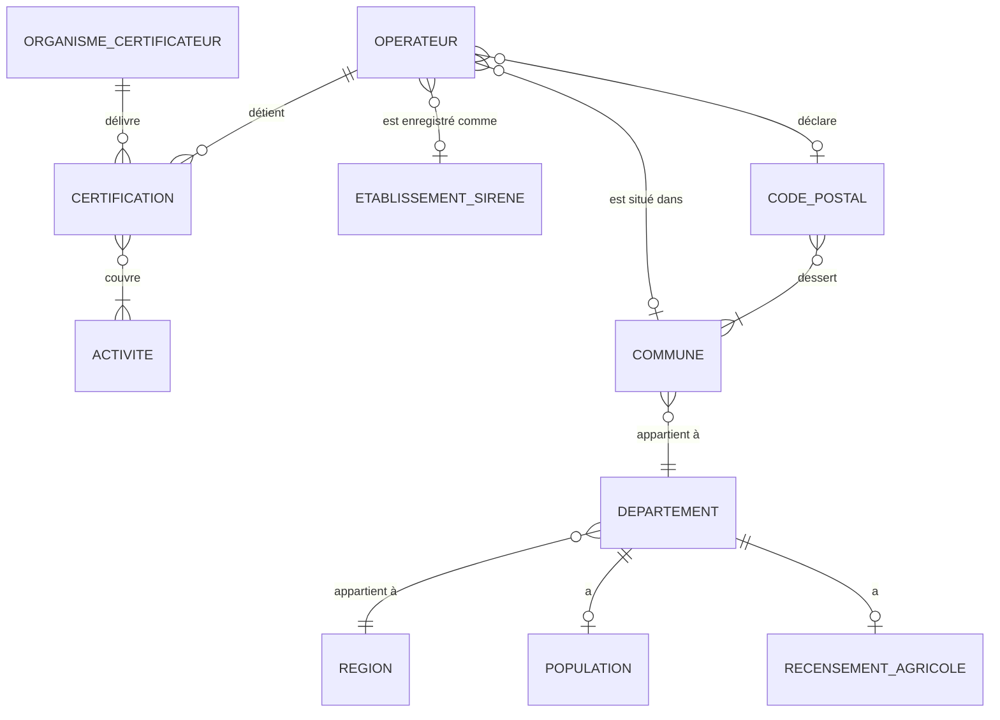
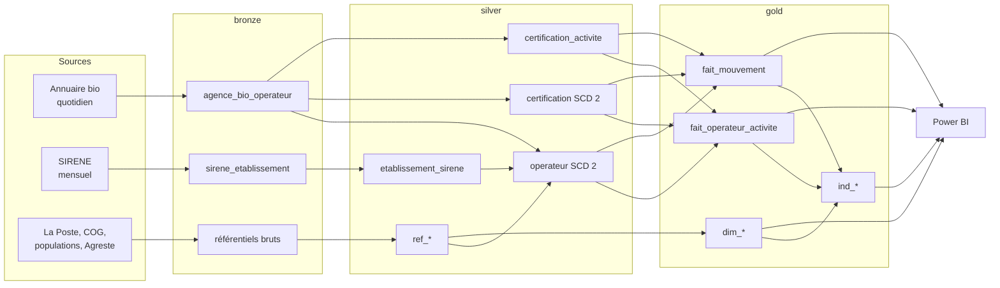
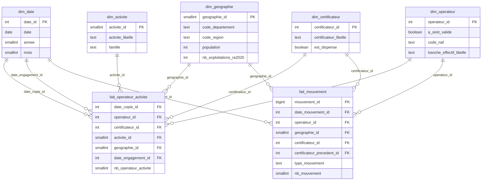
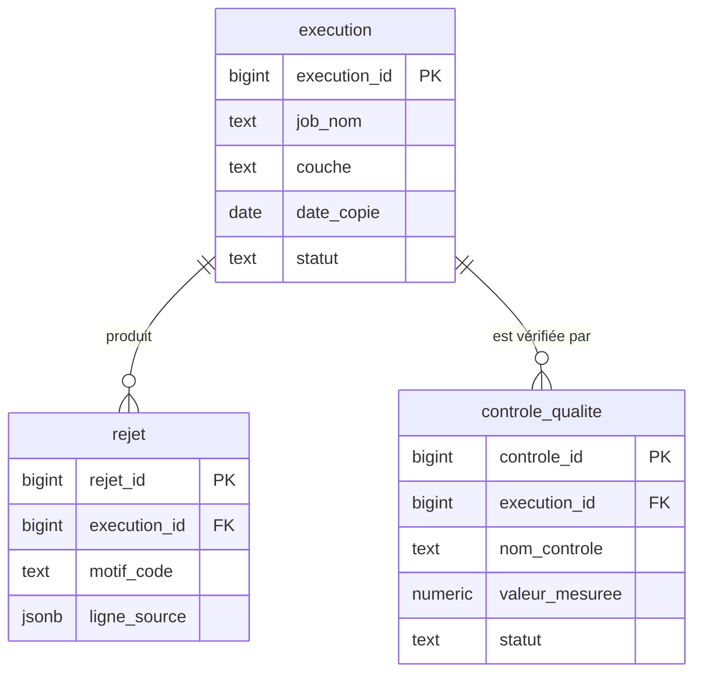

# Modèle de données — Observatoire territorial de la filière bio

Ce document décrit le modèle de données à trois niveaux, du plus abstrait au plus concret.

| Niveau | Question | Public |
|---|---|---|
| **Conceptuel** | Quelles informations le métier manipule-t-il, et comment sont-elles liées ? | Tout le monde, sans connaissance technique |
| **Logique** | Quelles tables, quelles clés, quelles relations, quel historique ? | Data engineer, analyste |
| **Physique** | Quels types PostgreSQL, quelles contraintes, quels index ? | Data engineer, administrateur de la base |

Les décisions s'appuient sur l'exploration des sources (`notebooks/exploration/01` à `04`).
Chaque table et chaque colonne sont détaillées dans le [dictionnaire de données](dictionnaire_donnees.md).

---

## 1. Principes communs

### 1.1 Le grain avant tout

Le **grain** d'une table, c'est ce que représente **une ligne**. On le fixe avant toute colonne,
car une erreur de grain fausse tous les comptages.

L'exploration a montré que le grain de l'annuaire n'est **pas l'opérateur** :
69 numéros bio apparaissent sur deux lignes, dont 67 avec **deux certificateurs différents**.
Une ligne de l'annuaire est donc une **certification** : un opérateur certifié par un organisme pour une ou plusieurs activités.
D'où le découpage en silver :

| Table silver | Grain (une ligne =) |
|---|---|
| `operateur` | un opérateur (un numéro bio), dans une version donnée |
| `certification` | un opérateur × un organisme certificateur, dans une version donnée |
| `certification_activite` | une version de certification × une activité |

### 1.2 Trois sortes de clés

| Clé | Définition | Exemple | Usage |
|---|---|---|---|
| **Naturelle** (ou métier) | Identifiant qui existe dans la source | `numero_bio`, `siret`, `code_commune` | Rapprocher les données d'un jour sur l'autre |
| **Technique** (ou de substitution, *surrogate*) | Entier généré par la base, sans signification | `operateur_version_id` | Clé primaire d'une version historisée, jointures rapides |
| **Empreinte** (*hash*) | Calcul (MD5) sur le contenu de la ligne | `hash_attributs` | Détecter en une comparaison qu'une ligne a changé |

En SCD 2, un même opérateur a plusieurs versions : la clé naturelle n'est plus unique, il faut une clé technique.
On garde aussi une **clé durable** `operateur_id`, attribuée une fois pour toutes au premier passage d'un numéro bio.
Elle relie toutes les versions d'un même opérateur et sert de clé à la dimension gold.

### 1.3 Conventions de nommage

- Tout en minuscules, mots séparés par `_` (*snake_case*), en français, au singulier : `operateur`, pas `Operateurs`.
- Préfixes de tables : `ref_` (référentiel), `fait_` (table de faits), `dim_` (dimension), `ind_` (indicateurs).
- Suffixes de colonnes : `_id` (clé), `_code` ou `code_` (code d'une nomenclature), `_libelle`, `date_`, `nb_` (comptage), `est_` / `a_` (booléen).
- En bronze, les colonnes techniques ajoutées par le chargement commencent par `_` pour les distinguer des colonnes de la source.

### 1.4 Ce qui fait foi (gouvernance)

| Information | Source qui fait foi | Pourquoi |
|---|---|---|
| Statut bio, activités, certificateur, date d'engagement | Annuaire Agence Bio | C'est sa mission officielle |
| Localisation de l'établissement | SIRENE (code commune), sinon déduction depuis le code postal | SIRENE donne la commune exacte, alors qu'un code postal couvre jusqu'à 46 communes |
| Hiérarchie commune → département → région | COG INSEE | Référentiel officiel, versionné par année |
| Population | INSEE, population municipale (PMUN) | Ne compte personne deux fois |
| Exploitations agricoles | Agreste, RA 2020 | Seul recensement exhaustif |

Les écarts entre sources ne sont jamais corrigés à la main. Ils sont **comptés** par les contrôles qualité.

---

## 2. Modèle conceptuel

On décrit les objets du métier et leurs liens, sans parler de tables.

**Comment lire les cardinalités :** `||` = exactement un, `o|` = zéro ou un, `|{` = un ou plusieurs, `o{` = zéro ou plusieurs.

| Relation | Règle métier | Constat qui la justifie |
|---|---|---|
| Opérateur → certification | Un opérateur a **une ou plusieurs** certifications | 69 numéros bio sur deux lignes |
| Certification → activité | Une certification couvre **1 à 6** activités parmi 8 | Colonne `ACTIVITES` multi-valuée |
| Code postal ↔ commune | Relation **plusieurs à plusieurs** | Un code postal dessert jusqu'à 46 communes, une commune a jusqu'à 6 codes postaux |
| Opérateur → établissement SIRENE | **Zéro ou un** | 701 opérateurs sans SIRET, 11 SIRET invalides |
| Opérateur → commune | **Zéro ou une** | Siège à l'étranger (`99132`, `98000`) ou code postal inconnu |

---

## 3. Modèle logique

### 3.1 Vue d'ensemble des flux

### 3.2 Bronze : la copie fidèle des sources

**Règle :** aucune transformation. Toutes les colonnes de la source sont gardées, **en texte**, avec leur nom d'origine mis en *snake_case*.
Un texte ne fait jamais échouer un chargement : une date invalide ou un SIRET mal formé arrive quand même en bronze, et c'est silver qui décide.

Chaque table bronze reçoit les mêmes **colonnes techniques** :

| Colonne | Rôle |
|---|---|
| `_execution_id` | Lien vers `audit.execution` : quel job a chargé la ligne |
| `_date_copie` | Date de la version de la source (date du fichier téléchargé) |
| `_fichier_source` | Nom du fichier lu |
| `_numero_ligne` | Position dans le fichier, pour retrouver une ligne exacte |
| `_hash_ligne` | Empreinte MD5 de la ligne brute : clé technique, l'annuaire n'ayant pas de clé naturelle unique |
| `_date_chargement` | Horodatage de l'écriture en base |

| Table bronze | Source | Colonnes de la source | Rétention |
|---|---|---|---|
| `agence_bio_operateur` | Annuaire Agence Bio | 7 : `siret`, `numero_bio`, `denomination`, `code_postal_siege_social`, `dateengagement`, `activites`, `organisme_certificateur` | 30 derniers chargements |
| `laposte_code_postal` | La Poste | 5 : `code_commune_insee`, `nom_de_la_commune`, `code_postal`, `libelle_d_acheminement`, `ligne_5` | Dernière version |
| `insee_cog_commune` | COG INSEE | 12 : `typecom`, `com`, `reg`, `dep`, `ctcd`, `arr`, `tncc`, `ncc`, `nccenr`, `libelle`, `can`, `comparent` | Une version par millésime |
| `insee_cog_departement` | COG INSEE | 7 : `dep`, `reg`, `cheflieu`, `tncc`, `ncc`, `nccenr`, `libelle` | Une version par millésime |
| `insee_cog_region` | COG INSEE | 6 : `reg`, `cheflieu`, `tncc`, `ncc`, `nccenr`, `libelle` | Une version par millésime |
| `insee_population_departement` | Populations légales | 9 : `reg`, `region`, `dep`, `departement`, `nbarr`, `nbcan`, `nbcom`, `pmun`, `ptot` | Une version par millésime |
| `agreste_ra2020` | Recensement agricole 2020 | 17 colonnes du format long (`geographie`, `code_geo`, `n110d_mod`, `ra2020_001_dim3_mod`, `valeur_extrapolee`…), **filtrées sur `geographie = 'DEP'`** pendant la lecture | Définitive (recensement décennal) |
| `sirene_etablissement` | SIRENE StockEtablissement | Les colonnes retenues par `04_sirene` (minimisation RGPD), **filtrées sur les SIRET de l'annuaire** pendant la lecture | 3 derniers stocks mensuels |

Deux filtres sont faits dès la lecture, alors que bronze ne transforme rien. Ce n'est pas une contradiction :
on **sélectionne des lignes**, on ne modifie aucune valeur. Sans ce filtre, Agreste (1,5 Go) et SIRENE (plusieurs Go) satureraient le disque
pour des lignes qui ne serviront jamais (règle de rétention du cadrage).

### 3.3 Silver : les données nettoyées, typées et historisées

#### Les référentiels

| Table | Clé primaire | Contenu | Source |
|---|---|---|---|
| `ref_region` | `code_region` | Code et libellé des régions | COG |
| `ref_departement` | `code_departement` | Code, libellé, région. Plus deux membres spéciaux : `99` = étranger, `00` = inconnu | COG |
| `ref_commune` | `code_commune` | Communes de plein exercice (`COM`) et arrondissements (`ARM`), avec leur département. Les communes déléguées et associées sont ramenées à leur parent | COG |
| `ref_code_postal_commune` | `code_postal` + `code_commune` | Table d'association plusieurs à plusieurs | La Poste |
| `ref_activite` | `activite_code` | Les 8 activités, leur libellé et leur famille | Annuaire, valeurs observées |
| `ref_certificateur` | `certificateur_id` | Les organismes, et un drapeau pour « Dispense de certification » | Annuaire, valeurs observées |
| `ref_tranche_effectif` | `tranche_code` | Code SIRENE → libellé, borne basse, borne haute | Documentation INSEE |
| `population_departement` | `code_departement` + `annee` | Population municipale | INSEE |
| `exploitation_departement` | `code_departement` + `annee` | Exploitations, SAU, ETP, PBS, et nombre par orientation (OTEX), **pivotés en colonnes** | Agreste |

Le pivot d'Agreste (format long → une colonne par indicateur) a été prototypé dans le notebook `02`.
En production, c'est un job Talend (`tDenormalize` ou `tPivotToColumnsDelimited`) qui le fait.

Familles d'activités dans `ref_activite` :

| Famille | Activités | Usage |
|---|---|---|
| `production` | Production | Numérateur de la densité, dénominateur des ratios de l'axe 1 |
| `transformation` | Préparation | Ratio de transformation |
| `distribution` | Distribution, Restauration | Ratio de distribution (la restauration vend au consommateur final) |
| `logistique` | Stockage, Transport | Affichage |
| `echanges` | Importation, Exportation | Affichage |

#### Les tables historisées (SCD 2)

**Le principe du SCD 2 :** au lieu d'écraser une ligne quand elle change, on **ferme** l'ancienne version et on **ouvre** une nouvelle.

| Colonne | Rôle |
|---|---|
| `date_debut` | Date de la copie où cette version est apparue |
| `date_fin` | Date de la copie où elle a disparu ou changé. Vide tant qu'elle est en cours |
| `est_courant` | `true` pour la version en cours, ce qui évite de filtrer sur `date_fin is null` partout |
| `hash_attributs` | Empreinte des colonnes suivies, pour détecter un changement en une comparaison |

L'intervalle est **semi-ouvert** `[date_debut, date_fin[` : une version est valable le jour de son début, mais plus le jour de sa fin.
Ainsi, deux versions successives ne se chevauchent jamais.

**Exemple :** l'opérateur `12345` passe d'Ecocert à Certipaq le 10 mars.

| certification_version_id | numero_bio | certificateur | date_debut | date_fin | est_courant |
|---|---|---|---|---|---|
| 501 | 12345 | Ecocert France | 2026-11-05 | 2027-03-10 | false |
| 9 830 | 12345 | Certipaq Bio | 2027-03-10 | | true |

**Retrouver l'état à une date D** (requête *as of*) : `date_debut <= D and (date_fin is null or date_fin > D)`.
C'est ce qui permet de recalculer n'importe quelle copie passée sans la stocker.

| Table | Clé technique | Clé naturelle | Colonnes suivies (un changement crée une version) |
|---|---|---|---|
| `operateur` | `operateur_version_id` | `numero_bio` | `siret`, `denomination`, `code_postal`, `code_commune`, `code_departement`, `methode_rattachement` |
| `certification` | `certification_version_id` | `numero_bio` + `certificateur_id` | `date_engagement`, liste triée des activités |
| `certification_activite` | `certification_version_id` + `activite_code` | — | Aucune : elle suit sa version de certification |

**Pourquoi historiser la certification à part ?** Un changement de certificateur n'est pas un changement d'opérateur.
En séparant les deux, on voit directement l'axe 3 : une certification Ecocert se ferme et une certification Certipaq s'ouvre le même jour pour le même numéro bio.

**Trois événements à détecter à chaque chargement**, en comparant la copie du jour aux versions courantes :

| Cas | Détection | Action |
|---|---|---|
| Nouvelle clé | Absente des versions courantes | Ouvrir une version |
| Clé modifiée | Présente, mais `hash_attributs` différent | Fermer l'ancienne version, ouvrir une nouvelle |
| Clé disparue | Version courante absente de la copie du jour | Fermer la version (c'est une **sortie**) |

Côté Talend, le composant `tPostgresqlSCD` gère les deux premiers cas.
Il ne voit pas les disparitions : un `tMap` en **anti-jointure** (lignes courantes sans correspondance dans la copie du jour) ferme ces versions.

**Le premier chargement :** toutes les versions commencent le 2026-11-05, date de la première copie.
Ce ne sont pas des entrées dans la filière : elles sont marquées `est_chargement_initial = true` et exclues des mouvements.
L'historique des entrées antérieures vient de `date_engagement`.

#### Les règles de nettoyage

| Donnée | Règle | Si la règle échoue |
|---|---|---|
| `numero_bio` | Obligatoire, entier | Ligne **rejetée** (`audit.rejet`, motif `NUMERO_BIO_ABSENT`) |
| `siret` | Retirer espaces et caractères invisibles (U+202C), puis 14 chiffres et clé de Luhn valide (exception La Poste, SIREN 356000000) | Valeur mise à vide, `siret_statut` = `ABSENT`, `TEXTE_NONE`, `FORMAT_INVALIDE` ou `LUHN_INVALIDE`. L'opérateur est gardé |
| `code_postal` | Retirer les espaces, compléter à 5 chiffres (`8850` → `08850`) | `code_postal_statut` = `INCONNU_LA_POSTE` (souvent un CEDEX). L'opérateur est gardé |
| `date_engagement` | Date au format ISO. `None` → vide | Une date postérieure à la copie est mise à vide, `date_engagement_statut` = `FUTURE` |
| `activites` | Découper sur `,`, retirer les espaces, contrôler dans `ref_activite` | Activité inconnue → rejet de la ligne d'activité (motif `ACTIVITE_INCONNUE`) |
| `organisme_certificateur` | Contrôler dans `ref_certificateur` | Organisme inconnu → ajouté au référentiel et signalé par le contrôle qualité |
| Doublon `numero_bio` + certificateur (2 cas) | Fusion : union des activités, date d'engagement la plus ancienne | Fusion tracée dans `audit.rejet`, motif `DOUBLON_FUSIONNE` |
| Codes postaux différents pour un même numéro bio (1 cas) | On garde celui de la certification la plus récente | Compté par le contrôle qualité |

On **rejette** le moins possible : une ligne sans SIRET reste un opérateur bio, et elle compte dans les indicateurs.
Une valeur douteuse est mise à vide et **qualifiée** par une colonne `_statut`, qu'on peut compter.

#### Le rattachement géographique de l'opérateur

La colonne `methode_rattachement` trace comment le département a été trouvé, dans cet ordre de priorité :

| Méthode | Règle | Part attendue |
|---|---|---|
| `SIRENE` | SIRET valide trouvé dans SIRENE : code commune de l'établissement → département (COG) | Majorité, à mesurer |
| `LAPOSTE_UNIQUE` | Le code postal ne dessert que des communes d'un même département | 99,1 % des codes postaux |
| `DEDUCTION_CP` | Code postal ambigu ou absent de La Poste : `97x` → 3 chiffres, `20` → `2A` si le 3e chiffre est 0 ou 1, sinon `2B`, sinon les 2 premiers chiffres | Le reste |
| `ETRANGER` | `99xxx` (code pays INSEE) ou `980xx` (Monaco) | Quelques cas |
| `INCONNU` | Aucune règle ne s'applique | Doit rester proche de 0 |

`code_commune` n'est renseigné que par la méthode `SIRENE`, ou par La Poste quand le code postal ne dessert qu'une commune.

#### SIRENE en silver

`etablissement_sirene` garde **une ligne par SIRET**, issue du dernier stock mensuel (pas d'historique SCD 2 : SIRENE garde déjà sa propre date de dernier changement, `date_debut_etat`).
`[ND]` devient vide. Les coordonnées Lambert 93 sont converties en nombres.

### 3.4 Gold : le modèle en étoile

**Pourquoi une étoile ?** Power BI travaille le mieux avec une table de faits (les événements à compter) entourée de dimensions (les axes d'analyse).
Chaque filtre (« Région Occitanie, activité Préparation, année 2027 ») devient une simple jointure.

Le projet a **deux tables de faits** qui partagent les mêmes dimensions : c'est un **schéma en constellation** (ou *galaxie*).

#### Les tables de faits

| Table | Type de fait | Grain | Mesure |
|---|---|---|---|
| `fait_operateur_activite` | **Instantané périodique** (*periodic snapshot*) : une photo de la filière à une date | Une date de copie × une certification × une activité | `nb_operateur_activite` = 1 |
| `fait_mouvement` | **Transactionnel** : un événement | Un mouvement d'un opérateur à une date | `nb_mouvement` = 1 |

Types de mouvements : `ENTREE`, `SORTIE`, `CHANGEMENT_CERTIFICATEUR`, `CHANGEMENT_ACTIVITES`, `CHANGEMENT_DEPARTEMENT`.
Pour un changement de certificateur, `certificateur_precedent_id` donne l'organisme quitté.

**Attention au comptage :** un opérateur à 3 activités a 3 lignes dans `fait_operateur_activite`.
Le nombre d'opérateurs se calcule donc en **valeurs distinctes** de `operateur_id` (`DISTINCTCOUNT` en DAX), jamais en somme.
La somme compte des couples opérateur × activité, ce qui est juste pour « nombre de préparateurs », faux pour « nombre d'opérateurs ».

**Rétention :** gold est recalculé à chaque exécution depuis silver (requête *as of*).
L'instantané garde les **30 dernières copies quotidiennes** et **une copie par fin de mois** au-delà.
Une photo par jour pendant des années ferait des dizaines de millions de lignes à importer dans Power BI, sans apport pour une analyse mensuelle.

#### Les dimensions

| Dimension | Grain | Points clés |
|---|---|---|
| `dim_date` | Un jour, de 1994 (premières certifications) à fin d'année suivante | Clé `date_id` au format `AAAAMMJJ` (lisible et triable). **Dimension à rôles multiples** (*role-playing*) : la même table sert pour la date de copie, la date d'engagement et la date de mouvement |
| `dim_geographie` | Un **département** (plus « étranger » et « inconnu ») | Région, population, exploitations RA 2020. Le département est le niveau le plus fin qu'on connaît pour **tous** les opérateurs, et celui des populations et d'Agreste |
| `dim_activite` | Une activité | Libellé, famille |
| `dim_certificateur` | Un organisme | `est_dispense` permet d'exclure la dispense des parts de marché et du HHI : ce n'est pas un organisme |
| `dim_operateur` | Un opérateur (clé durable) | **Aucune donnée personnelle** : ni nom, ni SIRET, ni numéro bio. Seulement des attributs descriptifs (SIRET valide ou non, NAF, tranche d'effectifs, actif dans SIRENE). Type 1 : on garde l'état courant, l'historique étant porté par les faits |

**Membres « inconnu » :** chaque dimension a une ligne de clé `-1` (« Inconnu »).
Un fait dont la dimension manque pointe vers `-1` au lieu de disparaître dans une jointure. Les totaux restent justes.

**Pourquoi ni numéro bio ni SIRET en gold ?** Le numéro bio est public : on le retrouve dans l'annuaire avec le nom de l'opérateur,
souvent une personne (entrepreneur individuel). Le garder en gold permettrait de **réidentifier** les personnes depuis Power BI.
La clé durable `operateur_id` est un **pseudonyme** : la table de correspondance reste en silver, dont l'accès est restreint.

#### Les tables d'indicateurs

Calculées par Talend depuis l'étoile, pour les indicateurs complexes qu'on ne veut pas recoder en DAX.

| Table | Grain | Indicateurs |
|---|---|---|
| `ind_structure_departement` | Département × date de copie | Nb de producteurs, préparateurs, distributeurs ; ratios de transformation et de distribution ; densité pour 10 000 habitants ; part des exploitations en bio ; quartiles ; `est_desert_transformation` |
| `ind_dynamique_departement_mois` | Département × mois | Entrées, sorties, solde net, engagements (par date d'engagement), croissance annuelle |
| `ind_marche_region` | Région × certificateur × date de copie | Part de marché, HHI de la région, rang, `est_leader` |

### 3.5 Audit : la traçabilité

| Table | Écrite par | Contenu |
|---|---|---|
| `execution` | Chaque job Talend (`etl_writer`), au début puis à la fin | Job, couche, date de copie, début, fin, statut, lignes lues, écrites, rejetées |
| `rejet` | Les jobs silver (`etl_writer`) | La ligne refusée (en JSON), son motif, l'exécution qui l'a refusée |
| `controle_qualite` | Les notebooks de contrôle (`qa_reader`, droit d'insertion) | Nom du contrôle, valeur mesurée, seuil, statut `OK` / `ALERTE` / `ECHEC` |

`rejet.ligne_source` peut contenir un nom de personne : sa rétention est limitée à **90 jours**.

---

## 4. Modèle physique (PostgreSQL 17)

### 4.1 Choix des types

| Donnée | Type | Pourquoi |
|---|---|---|
| Toutes les colonnes de source en bronze | `text` | Un chargement brut ne doit jamais échouer sur un format |
| Codes (postal, commune, département, NAF) | `text` + contrainte `CHECK` | Ce ne sont pas des nombres : `01400` deviendrait `1400`, `2A` serait impossible |
| SIRET | `char(14)` + `CHECK (siret ~ '^[0-9]{14}$')` | Longueur fixe, chiffres seuls. Texte et non nombre, pour garder les zéros de tête |
| `numero_bio` | `integer` | Identifiant numérique dans toute la source (rejet sinon) |
| Dates métier | `date` | Pas d'heure dans les sources |
| Horodatages techniques | `timestamptz` | Avec fuseau horaire : sans ambiguïté au changement d'heure, et identique sur le VPS |
| Clés techniques | `bigint generated always as identity` | Générées par la base, impossibles à saisir par erreur |
| Clés de dimensions gold | `smallint` / `integer` | Plus petites = jointures et import Power BI plus rapides |
| Ratios, parts, densités | `numeric(10,4)` | Calcul exact en base, sans erreur d'arrondi des flottants |
| Coordonnées Lambert 93 | `numeric(10,2)` | En mètres, au centimètre |
| Empreintes | `char(32)` | Un MD5 en hexadécimal fait toujours 32 caractères |
| Ligne rejetée | `jsonb` | Garde n'importe quelle structure de ligne, quelle que soit la source |

### 4.2 Contraintes

- **Clés primaires** sur toutes les tables silver, gold et audit. Pas en bronze : la source n'en a pas, et bronze doit tout accepter.
- **Clés étrangères** en silver et en gold : la base refuse une certification vers un certificateur inexistant.
  En gold, elles documentent l'étoile, et Power BI s'en sert pour détecter les relations.
- **Une seule version courante par clé naturelle** : index unique partiel
  `create unique index on silver.operateur (numero_bio) where est_courant;`.
  C'est la base, et non le job, qui garantit la cohérence du SCD 2.
- **Cohérence des dates** : `CHECK (date_fin is null or date_fin > date_debut)`.
- **Domaines** : `CHECK (statut in ('EN_COURS', 'SUCCES', 'ECHEC'))`, `CHECK (code_postal ~ '^[0-9]{5}$')`, etc.

### 4.3 Index

Un index accélère les lectures mais ralentit les écritures et prend de la place : on n'en crée que pour des requêtes connues.

| Table | Index | Requête servie |
|---|---|---|
| `bronze.agence_bio_operateur` | `(_date_copie)` | Lire la copie du jour, purger les copies au-delà de 30 |
| `silver.operateur`, `silver.certification` | Unique partiel sur la clé naturelle `where est_courant` | Comparer la copie du jour aux versions courantes |
| `silver.operateur`, `silver.certification` | `(date_debut, date_fin)` | Requêtes *as of* pour reconstruire gold |
| `silver.ref_code_postal_commune` | `(code_postal)` | Rattachement géographique |
| `silver.etablissement_sirene` | Clé primaire `siret` | Jointure avec l'opérateur |
| `gold.fait_*` | Une clé par colonne de dimension | Filtres des tables d'indicateurs |
| `audit.execution` | `(job_nom, date_copie)` | Dernière exécution d'un job |

### 4.4 Volumétrie estimée

| Table | Lignes | Croissance |
|---|---|---|
| `bronze.agence_bio_operateur` | ~2,6 millions (30 copies × 88 000) | Stable (purge) |
| `silver.operateur` | ~88 000 + les changements | Quelques milliers de versions par an |
| `silver.certification_activite` | ~135 000 + les changements | Idem |
| `gold.fait_operateur_activite` | ~135 000 par copie × (30 + 1 par mois) | ~1,6 million par an |
| `gold.fait_mouvement` | Quelques centaines par jour | ~100 000 par an |

### 4.5 Droits (rappel de `sql/init/03_privileges.sql`)

| Rôle | bronze | silver | gold | audit |
|---|---|---|---|---|
| `etl_writer` (Talend) | Propriétaire | Propriétaire | Propriétaire | Propriétaire |
| `qa_reader` (notebooks) | Lecture | Lecture | Lecture | Lecture + insertion |
| `bi_reader` (Power BI) | — | — | Lecture | — |

C'est ce qui garantit la règle RGPD : les noms ne sortent jamais de silver, car Power BI n'a aucun droit sur silver.

### 4.6 Évolutions possibles

- **Partitionnement** de `bronze.agence_bio_operateur` par `_date_copie` : la purge deviendrait un `DROP` de partition (instantané) au lieu d'un `DELETE` de 88 000 lignes.
  Inutile au volume actuel ; à envisager si le nombre de copies gardées augmente.
- **NAF 2025** : la colonne est prévue dans `etablissement_sirene`, à basculer quand l'INSEE l'imposera.
- **Commune** dans `dim_geographie` : possible pour les opérateurs localisés par SIRENE, si une carte plus fine est demandée.

Les scripts de création des tables (DDL) seront écrits dans `sql/ddl/`, couche par couche, au moment de construire les jobs Talend correspondants.
