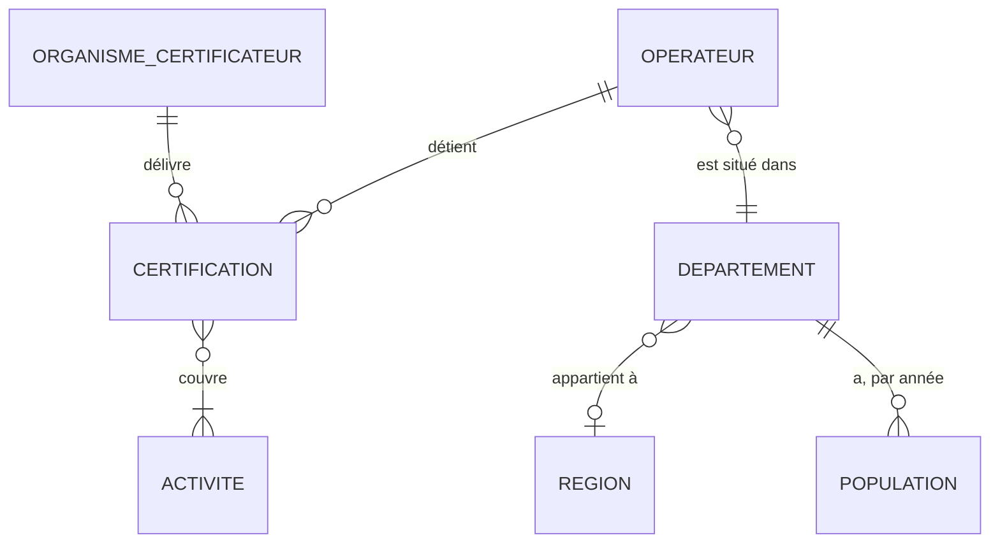
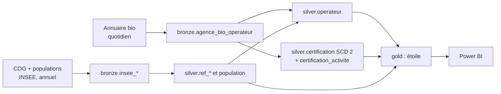
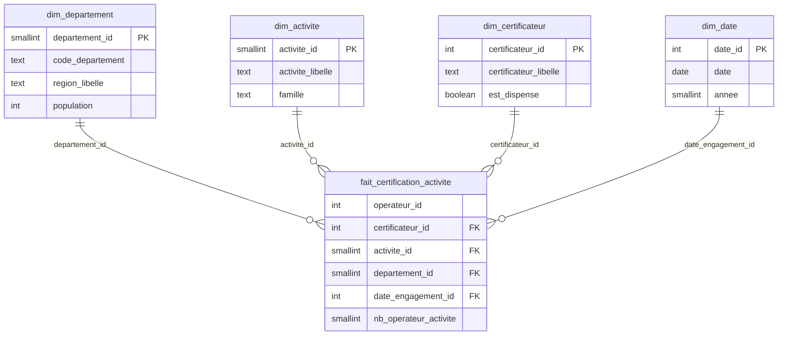

# Modèle de données — Observatoire territorial de la filière bio

Ce document décrit le modèle de données à trois niveaux, du plus abstrait au plus concret.

| Niveau | Question | Public |
|---|---|---|
| **Conceptuel** | Quelles informations le métier manipule-t-il, et comment sont-elles liées ? | Tout le monde |
| **Logique** | Quelles tables, quelles clés, quelles relations, quel historique ? | Data engineer, analyste |
| **Physique** | Quels types PostgreSQL, quelles contraintes, quels index ? | Data engineer, administrateur |

Chaque table et chaque colonne sont détaillées dans le [dictionnaire de données](dictionnaire_donnees.md).

---

## 1. Principes communs

### 1.1 Le grain avant tout

Le **grain** d'une table, c'est ce que représente **une ligne**. On le fixe avant toute colonne, car une erreur de grain fausse tous les comptages.

Le grain de l'annuaire n'est **pas l'opérateur** : 69 numéros bio apparaissent sur deux lignes, dont 67 avec **deux certificateurs différents**.
Une ligne de l'annuaire est une **certification** : un opérateur certifié par un organisme pour une ou plusieurs activités.

| Table silver | Grain (une ligne =) |
|---|---|
| `operateur` | un opérateur (un numéro bio), état courant |
| `certification` | un opérateur × un organisme certificateur, dans une version donnée (SCD 2) |
| `certification_activite` | une version de certification × une activité |

### 1.2 Trois sortes de clés

| Clé | Définition | Exemple |
|---|---|---|
| **Naturelle** (métier) | Identifiant qui existe dans la source | `numero_bio`, `code_departement` |
| **Technique** (*surrogate*) | Entier généré par la base, sans signification | `certification_version_id`, `operateur_id` |
| **Empreinte** (*hash*) | MD5 du contenu, pour détecter un changement en une comparaison | `_hash_ligne`, `hash_attributs` |

En SCD 2, une même certification a plusieurs versions : la clé naturelle n'est plus unique, d'où la clé technique.

### 1.3 Conventions de nommage

- Minuscules, mots séparés par `_`, en français, au singulier.
- Préfixes : `ref_` (référentiel), `fait_` (faits), `dim_` (dimension).
- Suffixes : `_id` (clé), `_libelle`, `_statut` (qualification d'une valeur), `date_`, `nb_`, `est_` (booléen).
- En bronze, les colonnes techniques commencent par `_`.

---

## 2. Modèle conceptuel

| Relation | Règle métier | Constat qui la justifie |
|---|---|---|
| Opérateur → certification | Un opérateur a **une ou plusieurs** certifications | 69 numéros bio sur deux lignes |
| Certification → activité | **1 à 6** activités parmi 8 | Colonne `ACTIVITES` multi-valuée |
| Opérateur → département | Exactement **un**, éventuellement « étranger » ou « inconnu » | Siège à l'étranger (`99132`, `98000`), code postal absent |
| Département → région | **Zéro ou une** : aucune pour les membres « étranger » et « inconnu » | |

---

## 3. Modèle logique

### 3.1 Les flux

### 3.2 Bronze : la copie fidèle des sources

Toutes les colonnes de la source, **en texte**, avec leur nom en *snake_case*. Un chargement brut ne doit jamais échouer sur un format : c'est silver qui décide.

Colonnes techniques communes : `_execution_id` (lien vers `audit.execution`), `_date_copie` (version de la source), `_fichier_source`, `_numero_ligne`, `_hash_ligne` (MD5 de la ligne), `_date_chargement`.

| Table bronze | Source | Colonnes de la source | Rétention |
|---|---|---|---|
| `agence_bio_operateur` | Annuaire Agence Bio | 7 : `siret`, `numero_bio`, `denomination`, `code_postal_siege_social`, `dateengagement`, `activites`, `organisme_certificateur` | 30 dernières copies |
| `insee_cog_departement` | COG INSEE | 7 : `dep`, `reg`, `cheflieu`, `tncc`, `ncc`, `nccenr`, `libelle` | Une version par millésime |
| `insee_cog_region` | COG INSEE | 6 : `reg`, `cheflieu`, `tncc`, `ncc`, `nccenr`, `libelle` | Une version par millésime |
| `insee_population_departement` | Populations légales | 9 : `reg`, `region`, `dep`, `departement`, `nbarr`, `nbcan`, `nbcom`, `pmun`, `ptot` | Une version par millésime |

Chaque job bronze est **idempotent** : il purge les lignes de la même version puis les réécrit, dans **une seule transaction**.

### 3.3 Silver : les données nettoyées, typées et historisées

#### Les référentiels

| Table | Clé primaire | Contenu | Source |
|---|---|---|---|
| `ref_region` | `code_region` | Code et libellé des régions | COG |
| `ref_departement` | `code_departement` | Code, libellé, région. Plus deux membres spéciaux : `99` étranger, `00` inconnu | COG |
| `population_departement` | `code_departement` + `annee` | Population municipale (PMUN) | INSEE |
| `ref_activite` | `activite_code` | Les 8 activités, leur libellé et leur famille | Valeurs observées dans l'annuaire |
| `ref_certificateur` | `certificateur_id` | Les organismes, et un drapeau pour « Dispense de certification » | Valeurs observées dans l'annuaire |

Familles d'activités :

| Famille | Activités | Usage |
|---|---|---|
| `production` | Production | Densité, dénominateur des ratios |
| `transformation` | Préparation | Ratio de transformation |
| `distribution` | Distribution, Restauration | Ratio de distribution |
| `logistique` | Stockage, Transport | Affichage |
| `echanges` | Importation, Exportation | Affichage |

#### L'opérateur : état courant (SCD 1)

`silver.operateur` garde **une ligne par numéro bio**, mise à jour à chaque copie : on écrase l'ancienne valeur (SCD de type 1).
L'historique utile aux analyses est porté par la certification.

`operateur_id` est une clé technique stable, attribuée au premier passage d'un numéro bio. Elle sert de **pseudonyme** en gold.

#### La certification : historique (SCD 2)

Au lieu d'écraser une certification quand elle change, on **ferme** l'ancienne version et on **ouvre** une nouvelle.

| Colonne | Rôle |
|---|---|
| `date_debut` | Copie où la version apparaît |
| `date_fin` | Copie où elle change ou disparaît. Vide tant qu'elle est en cours |
| `est_courant` | `true` pour la version en cours |
| `hash_attributs` | MD5 des colonnes suivies : `date_engagement` et liste triée des activités |

Intervalle semi-ouvert `[date_debut, date_fin[` : deux versions ne se chevauchent jamais.
État à une date D (requête *as of*) : `date_debut <= D and (date_fin is null or date_fin > D)`.

Clé naturelle : `numero_bio` + `certificateur_id`. Trois cas à chaque chargement :

| Cas | Détection | Action |
|---|---|---|
| Nouvelle clé | Absente des versions courantes | Ouvrir une version |
| Clé modifiée | Présente, `hash_attributs` différent | Fermer l'ancienne version, ouvrir une nouvelle |
| Clé disparue | Version courante absente de la copie du jour | Fermer la version (sortie, ou changement de certificateur si une autre certification s'ouvre le même jour) |

Le premier chargement ouvre toutes les versions au 2026-11-05 avec `est_chargement_initial = true` : ce ne sont pas des entrées dans la filière.

#### Les règles de nettoyage

| Donnée | Règle | Si la règle échoue |
|---|---|---|
| `numero_bio` | Obligatoire, entier | Ligne **rejetée** (`audit.rejet`, motif `NUMERO_BIO_ABSENT`) |
| `siret` | Retirer espaces et caractères invisibles, 14 chiffres, clé de Luhn (exception La Poste, SIREN 356000000) | Valeur vide, `siret_statut` = `ABSENT`, `TEXTE_NONE`, `FORMAT_INVALIDE` ou `LUHN_INVALIDE`. Ligne gardée |
| `code_postal` | Retirer les espaces, compléter à 5 chiffres (`8850` → `08850`) | `code_postal_statut` = `ABSENT` ou `FORMAT_INVALIDE`. Ligne gardée |
| `date_engagement` | Date ISO. `None` → vide | Date postérieure à la copie → vide, `date_engagement_statut` = `FUTURE` |
| `activites` | Découper sur `,`, contrôler dans `ref_activite` | Activité inconnue → rejet de la ligne d'activité (`ACTIVITE_INCONNUE`) |
| `organisme_certificateur` | Contrôler dans `ref_certificateur` | Organisme inconnu → ajouté au référentiel, signalé par le contrôle qualité |
| Doublon `numero_bio` + certificateur (2 cas) | Union des activités, date d'engagement la plus ancienne | Tracé dans `audit.rejet`, motif `DOUBLON_FUSIONNE` |

On rejette le moins possible : une valeur douteuse est mise à vide et **qualifiée** par une colonne `_statut`.

#### Le département de l'opérateur

Déduit du code postal nettoyé ; `methode_rattachement` trace la règle appliquée :

| Méthode | Règle |
|---|---|
| `CODE_POSTAL` | `97x` → les 3 premiers chiffres (outre-mer) ; `20` → `2A` si le 3e chiffre est 0 ou 1, sinon `2B` ; sinon les 2 premiers chiffres. Le code obtenu doit exister dans `ref_departement` |
| `ETRANGER` | `99xxx` (code pays INSEE) ou `980xx` (Monaco) → département `99` |
| `INCONNU` | Code postal absent, invalide, ou département obtenu inexistant → département `00` |

Limite connue : quelques codes postaux desservent des communes d'un département voisin ; l'écart est inférieur à 1 % (exploration `03_referentiel_geographique`).

### 3.4 Gold : le modèle en étoile

| Table | Grain | Points clés |
|---|---|---|
| `fait_certification_activite` | Une certification **en cours** × une activité | `nb_operateur_activite` = 1. `operateur_id` est une **dimension dégénérée** : un identifiant sans table de dimension, qui sert à compter les opérateurs distincts |
| `dim_departement` | Un département, plus « étranger » et « inconnu » | Région, population du dernier millésime |
| `dim_activite` | Une activité | Libellé, famille |
| `dim_certificateur` | Un organisme | `est_dispense` exclut la dispense des parts de marché et du HHI |
| `dim_date` | Un jour, de 1994 à fin d'année suivante | Clé `AAAAMMJJ`. Sert à la date d'engagement |

**Membres « inconnu » :** chaque dimension a une ligne de clé `-1`. Un fait dont la dimension manque pointe vers `-1` au lieu de disparaître dans une jointure.

**Piège du comptage :** un opérateur à 3 activités a 3 lignes. Nombre d'opérateurs = `DISTINCTCOUNT(operateur_id)` en DAX, jamais une somme.

**Pseudonymisation :** ni nom, ni SIRET, ni numéro bio en gold. Le numéro bio permettrait de retrouver le nom dans l'annuaire public.
`operateur_id` est un pseudonyme ; la correspondance reste en silver, inaccessible à Power BI.

**Les indicateurs** (ratios, densité, quartiles, désert, parts de marché, HHI) sont des **mesures DAX** dans Power BI, calculées à partir de l'étoile.

Gold est **recalculé entièrement** à chaque exécution à partir des versions courantes de silver.

### 3.5 Audit : la traçabilité

| Table | Écrite par | Contenu |
|---|---|---|
| `execution` | Chaque job Talend (`etl_writer`) | Job, couche, date de copie, début, fin, statut, lignes lues, écrites, rejetées |
| `rejet` | Les jobs silver (`etl_writer`) | La ligne refusée (JSON), son motif, l'exécution |
| `controle_qualite` | Le notebook de contrôle (`qa_reader`) | Nom du contrôle, valeur mesurée, seuil, statut `OK` / `ALERTE` / `ECHEC` |

---

## 4. Modèle physique (PostgreSQL 17)

### 4.1 Choix des types

| Donnée | Type | Pourquoi |
|---|---|---|
| Colonnes de source en bronze | `text` | Un chargement brut ne doit jamais échouer sur un format |
| Codes (postal, département, région) | `text` + `CHECK` | Ce ne sont pas des nombres : `01400` deviendrait `1400`, `2A` serait impossible |
| SIRET | `char(14)` + `CHECK (siret ~ '^[0-9]{14}$')` | Longueur fixe, zéros de tête gardés |
| `numero_bio` | `integer` | Identifiant numérique (rejet sinon) |
| Dates métier | `date` | Pas d'heure dans les sources |
| Horodatages techniques | `timestamptz` | Sans ambiguïté au changement d'heure |
| Clés techniques | `bigint` / `integer generated always as identity` | Générées par la base |
| Empreintes | `char(32)` | Un MD5 hexadécimal fait 32 caractères |
| Ligne rejetée | `jsonb` | N'importe quelle structure de ligne |

### 4.2 Contraintes

- **Clés primaires** sur toutes les tables silver, gold et audit. Pas en bronze : la source n'en a pas.
- **Clés étrangères** en silver et en gold, et de chaque ligne bronze vers son exécution.
- **Une seule version courante par clé naturelle** : `create unique index on silver.certification (numero_bio, certificateur_id) where est_courant;`
- **Cohérence des dates** : `CHECK (date_fin is null or date_fin > date_debut)`.
- **Domaines** : `CHECK (statut in (...))`, `CHECK (code_postal ~ '^[0-9]{5}$')`…

### 4.3 Index

On ne crée un index que pour une requête connue : il accélère les lectures mais ralentit les écritures.

| Table | Index | Requête servie |
|---|---|---|
| `bronze.agence_bio_operateur` | `(_date_copie)` | Lire ou purger une copie |
| `silver.certification` | Unique partiel `where est_courant` | Comparer la copie du jour aux versions courantes |
| `silver.operateur` | Unique sur `numero_bio` | Mise à jour de l'état courant |
| `gold.fait_certification_activite` | Une par colonne de dimension | Filtres |
| `audit.execution` | `(job_nom, date_copie)` | Dernière exécution d'un job |

### 4.4 Droits

| Rôle | bronze | silver | gold | audit |
|---|---|---|---|---|
| `etl_writer` (Talend) | Propriétaire | Propriétaire | Propriétaire | Propriétaire |
| `qa_reader` (notebook) | Lecture | Lecture | Lecture | Lecture + insertion dans `controle_qualite` |
| `bi_reader` (Power BI) | — | — | Lecture | — |

Les noms ne sortent jamais de silver, car Power BI n'a aucun droit sur silver.

### 4.5 Scripts

Les scripts de création des tables sont dans `sql/init/`, un par couche (`04_audit.sql`, `05_bronze.sql`, `06_silver.sql`, puis gold).
`07_silver_fusion.sql` contient les procédures appelées par `silver_annuaire` : le nettoyage ligne par ligne est fait par Talend
(routine `Nettoyage`, jointure sur `ref_departement`) dans la table de travail `silver.annuaire_prepare` ; la fusion par ensembles
(rejets, organismes, opérateurs en SCD 1, certifications en SCD 2) est faite par ces procédures, dans la transaction du job.
Les copies se traitent dans l'ordre chronologique : `verifier_ordre_copie` refuse une copie plus ancienne que la dernière historisée.
Les scripts sont
exécutés à la création de la base et testés par la CI (`sql/tests/test_init.sql`).
Ils ne s'appliquent qu'à une base vide : sur un serveur, les évolutions passeraient par des scripts de migration.
